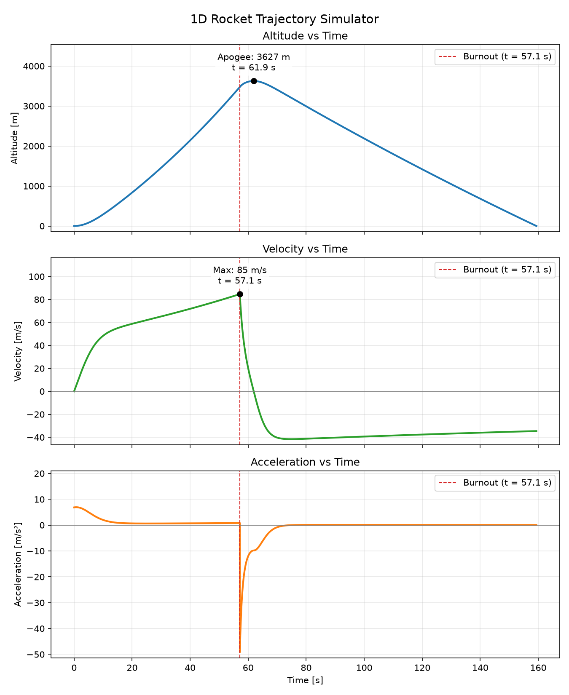
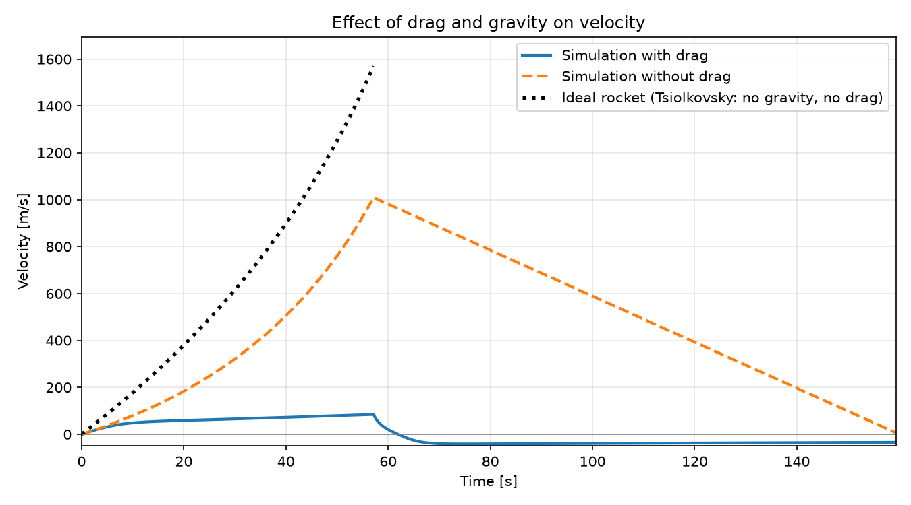

# Rocket Trajectory Simulator 1D

A **1D vertical rocket launch simulator** written in Python, with graphical output. It models **thrust**, **gravity**, **atmospheric drag** and **variable mass** (propellant consumption), integrating the equations of motion with **4th-order Runge-Kutta (RK4)**.

[](plots/trajectory_overview.png)

## Features

- `Rocket` class with configurable parameters (dry mass, propellant, thrust, flow rate, `Cd`, area…)
- **Constant** or **variable** thrust (via a `t -> N` function)
- Exponential atmosphere and **constant** or **altitude-dependent** gravity
- **RK4** integrator with step adjustment exactly at burnout and ground-impact detection
- Terminal report: apogee, maximum velocity, burn time, Max-Q, impact velocity…
- **Comparison with the ideal rocket equation** (Tsiolkovsky), breaking down gravity and drag losses
- Altitude, velocity and acceleration plots saved automatically to `plots/`
- Type hints and docstrings throughout

## Project structure

```
rocket-trajectory-sim/
├── README.md
├── requirements.txt
├── src/
│   ├── __init__.py
│   ├── rocket.py        # Rocket class (parameters, mass and thrust over time)
│   ├── physics.py       # pure physics functions (gravity, density, drag, Tsiolkovsky)
│   └── simulation.py    # RK4 integrator, flight summary and plots
├── examples/
│   └── simple_launch.py # launch using the example parameters
└── plots/               # generated plots (PNG)
```

## Installation

Requires **Python 3.10+**.

```bash
git clone https://github.com/<seellye>/rocket-trajectory-sim.git
cd rocket-trajectory-sim

# (optional) virtual environment
python -m venv .venv
source .venv/bin/activate        # Windows: .venv\Scripts\activate

pip install -r requirements.txt
```

## Usage

From the repository root:

```bash
python examples/simple_launch.py
```

Available options:

| Option               | Description                                              |
|----------------------|----------------------------------------------------------|
| `--variable-gravity` | Use altitude-dependent gravity (`g ∝ 1/r²`)              |
| `--dt 0.005`         | Change the integration time step (default: `0.01` s)     |
| `--no-show`          | Do not open plot windows; only save the PNGs to `plots/` |

### Using it as a library

```python
from src.rocket import Rocket
from src.simulation import SimulationConfig, simulate, summarize

rocket = Rocket(
    dry_mass=50.0, fuel_mass=100.0, thrust=3000.0,
    mass_flow_rate=2.5, drag_coefficient=0.5, reference_area=0.1,
)
result = simulate(rocket, SimulationConfig(dt=0.01))

print(summarize(result).apogee)          # maximum altitude [m]
# result.time, result.altitude, result.velocity, result.acceleration  -> NumPy arrays
```

Variable thrust (4 s ramp up to the nominal thrust):

```python
rocket = Rocket(
    50.0, 100.0, 3000.0, 2.5, 0.5, 0.1,
    thrust_profile=lambda t: 3000.0 * min(1.0, 0.5 + t / 4.0),
)
```

## Physics

The state is `(h, v)` (altitude and velocity, positive upward):

$$\frac{dh}{dt} = v \qquad \frac{dv}{dt} = a = \frac{T - D - m\,g}{m}$$

| Quantity | Model |
|----------|-------|
| **Thrust** `T` | Constant (or `thrust_profile(t)`) while propellant remains; zero afterwards |
| **Mass** `m(t)` | $m(t) = m_0 - \dot m\,t$ until burnout; afterwards $m = m_{dry}$ |
| **Burn time** | $t_b = m_{fuel} / \dot m$ |
| **Gravity** `g` | Constant: $9.80665\ m/s^2$. Optional: $g(h) = g_0\,\big(R/(R+h)\big)^2$ |
| **Air density** | Exponential: $\rho(h) = \rho_0\,e^{-h/H}$, with $\rho_0 = 1.225\ kg/m^3$ and $H = 8500\ m$ |
| **Drag** `D` | $D = \tfrac{1}{2}\,\rho\,v\,\lvert v\rvert\,C_d\,A$ (the $v\lvert v\rvert$ term makes drag always oppose the motion) |
| **Integration** | 4th-order Runge-Kutta, fixed step `dt` (adjusted to end exactly at burnout) |

### Ideal rocket equation (Tsiolkovsky)

With no gravity and no drag, the velocity gain is

$$\Delta v = v_e \ln\frac{m_0}{m_f}, \qquad v_e = \frac{T}{\dot m}$$

The program uses this as a theoretical ceiling and breaks down the gap to the real burnout velocity into **gravity loss** and **drag loss** (by simulating the same rocket with and without drag).

### Validation

With drag turned off, the RK4 simulation matches the analytical solution (burnout altitude and velocity, apogee and flight time) to numerical precision, and results already converge at `dt = 0.1 s`.

## Example output

Parameters: dry mass 50 kg · propellant 100 kg · thrust 3000 N · consumption 2.5 kg/s · Cd 0.5 · A 0.1 m².

```text
==========================================================
  1D ROCKET TRAJECTORY SIMULATOR
==========================================================
  Rocket
  Initial mass                           150.0 kg
  Dry mass                                50.0 kg
  Nominal thrust                          3000 N
  Thrust-to-weight ratio (T/W)            2.04
  Specific impulse (Isp)                 122.4 s

  Flight results
  Burn time                               40.0 s
  Burnout altitude                      8305.7 m
  Burnout velocity                       405.2 m/s
  Maximum altitude (apogee)            12001.6 m
  Time to apogee                          64.6 s
  Maximum velocity                       405.2 m/s
    occurs at t =                         40.0 s
  Maximum acceleration                    12.3 m/s²
  Maximum deceleration                   -47.7 m/s²
  Max dynamic pressure (Max-Q)            37.8 kPa
    occurs at t =                         40.0 s
  Total flight time                      144.2 s
  Impact velocity                       -134.0 m/s
==========================================================

==========================================================
  COMPARISON WITH THE IDEAL ROCKET EQUATION
==========================================================
  Ideal Δv (Tsiolkovsky)                  1318.3 m/s
  (-) gravity loss                         392.3 m/s
  (-) drag loss                            520.9 m/s
  (=) simulated burnout velocity           405.2 m/s
  Efficiency: 30.7% of ideal Δv
==========================================================
```

Plots generated in `plots/`:

| File | Content |
|------|---------|
| `altitude_vs_time.png` | Altitude vs Time |
| `velocity_vs_time.png` | Velocity vs Time |
| `acceleration_vs_time.png` | Acceleration vs Time |
| `trajectory_overview.png` | The three plots stacked |
| `velocity_comparison.png` | Velocity with drag vs without drag vs ideal rocket |



> **Note:** the impact velocity (≈ 134 m/s) is higher than the sea-level terminal velocity (≈ 127 m/s) because the rocket falls from altitudes where the air is thinner. The sharp deceleration peak right after burnout comes from high drag at ~400 m/s combined with the sudden loss of thrust.

## Model limitations

- **Vertical-only** motion (1D): no wind, no Earth rotation and no launch angle
- Constant `Cd` (in practice it varies with Mach number, especially near the speed of sound)
- Simple exponential atmosphere (no temperature layers)
- Thrust independent of ambient pressure (no sea-level vs vacuum correction)
- No parachute: the rocket free-falls until impact

## Possible future improvements

- [ ] Unit tests with `pytest` (comparison against the analytical no-drag solution)
- [ ] Layered ISA standard atmosphere
- [ ] `Cd` as a function of Mach number
- [ ] Ambient-pressure-dependent thrust (sea-level vs vacuum `Isp`)
- [ ] Multiple stages and staging events
- [ ] Parachute and recovery phase
- [ ] 2D/3D trajectory with launch angle and wind
- [ ] Load parameters from a file (YAML/JSON) or CLI
- [ ] Ascent animation with `matplotlib.animation`
- [ ] Packaging (`pyproject.toml`) for `pip install`

## License

Choose the license you prefer (e.g. MIT) before publishing.
